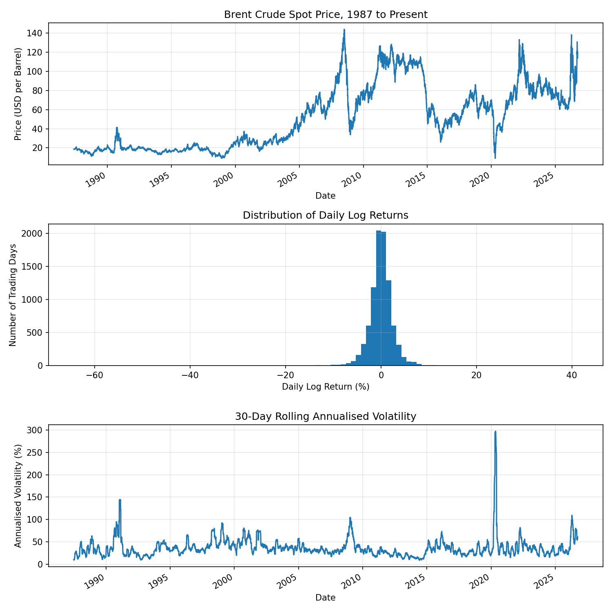
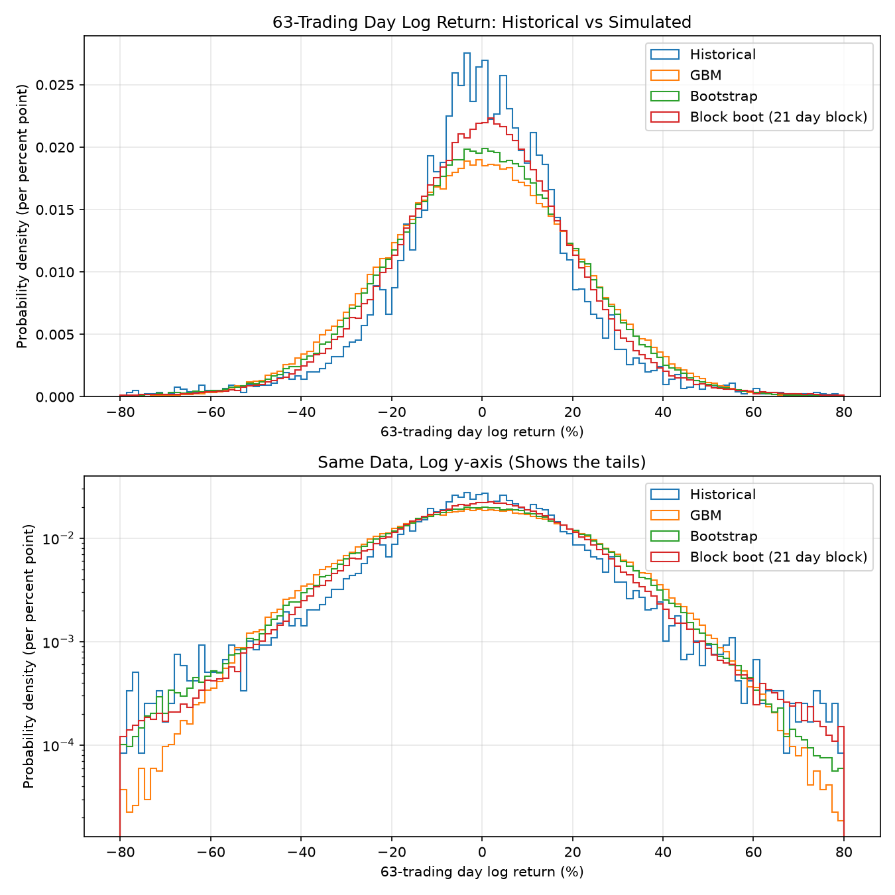
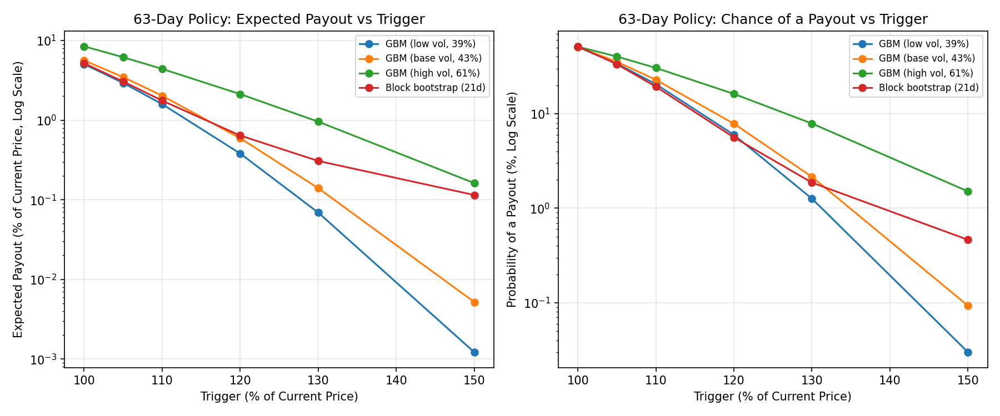
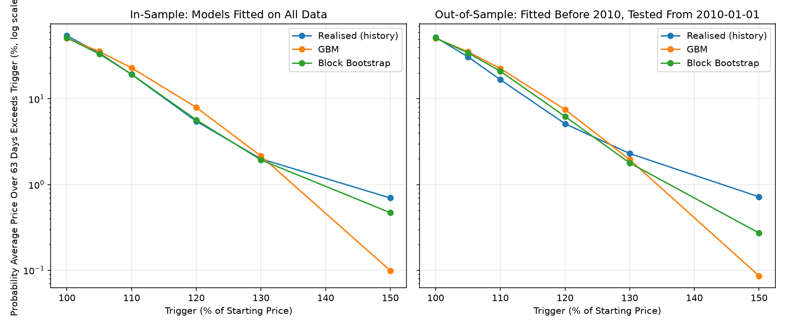

# Energy Price Risk: Brent Crude Trigger-Payout Pricing


A Python project that studies Brent crude price behaviour and prices a simple
"pay the excess above a trigger" policy by Monte Carlo simulation.
This is an educational project and not a production pricing model.

## Question

How likely is a given energy price trigger to be breached, and what is the
expected payout of a policy that pays the excess above it?

The policy pays `max(A - K, 0)` per barrel, where `A` is the average daily
Brent price over the policy term and `K` is the trigger, set as a percentage
of the price on the start date.

## Summary

- A 63-day policy with a trigger at 110% of today's price (125.36 USD) has an
  expected payout of 2.00 USD per barrel under the central model (21-day block
  bootstrap), or a premium of 2.40 USD with an assumed 20% loading.
- The volatility assumption moves the price more than the choice of model:
  the expected payout ranges from 1.81 to 5.02 USD across the cases tested.
- In a backtest against history, both models' breach probabilities are within
  about 1.3 standard errors of what happened. Out of sample, realised payouts
  above a 120% trigger exceed both models, but most of that gap comes from
  windows starting in March-June 2020.

## Data

- Series: Europe Brent Spot Price FOB, daily, USD per barrel (FRED: DCOILBRENTEU, from the US EIA).
- Primary file: `data/raw/brent_fred.csv`. Backup: `data/raw/brent_datahub.csv` (DataHub copy of the EIA data).
- Downloaded: 1 October 2026. Raw files are unmodified; all cleaning happens in code.
- Coverage: 20 May 1987 to 29 September 2026. 9,097 price observations
  (about 231 per year, as holidays are missing).
- Cross-check (`scripts/crosscheck_data_sources.py`): FRED and DataHub compared by date.
  Both files have 9,097 rows and the same date range. Maximum absolute
  difference is 0.0, with 0 rows differing by more than 0.005 and 0 dates present
  in only one file. Both files share the same upstream source (the EIA), so this
  confirms the download and parsing, not the EIA's own accuracy.

## Setup

```bash
python -m venv .venv
.venv\Scripts\activate
python -m pip install -e .
python -m pip install -r requirements.txt   # optional: the exact versions used
```

## Run

```bash
python scripts/run_all.py     # runs every analysis script in order
python -m pytest -v           # runs the test suite
```

Scripts can also be run individually from the repo root, for example
`python scripts/pricing_sensitivity_analysis.py`. Figures are saved to `figures/`
and result tables to `results/`.

## Project structure

```text
src/energy_risk/     # core functions: data, returns, simulate, pricing, sensitivity, backtest
scripts/             # runnable analysis scripts
tests/               # pytest suite
data/raw/            # source CSVs
results/             # output tables (CSV)
figures/             # saved plots
.github/workflows/   # automated tests
```

## Testing

`python -m pytest -v` runs 40 tests covering data loading, returns, volatility, VaR,
the GBM and bootstrap simulators, pricing functions, sensitivity sweep and the backtest. Checks include hand
calculations, reproducibility with fixed seeds, and a comparison of the Monte Carlo
call price with the Black-Scholes formula (agreement within 4 standard errors).

## Exploratory results

- Daily log returns: std 2.69%, skew -1.53, excess kurtosis 53.7 (very fat tails).
- Historical 95% daily VaR: 3.79% (downside), 3.70% (upside).
- Days with |log return| above 0.25, confirmed identical in both source files:

| Date       | Price change (USD/bbl) | Simple change | Log return |
| ---------- | ---------------------- | ------------- | ---------- |
| 1991-01-17 | 30.28 to 21.10         | -30.3%        | -0.361     |
| 2020-03-09 | 45.60 to 35.33         | -22.5%        | -0.255     |
| 2020-03-31 | 19.19 to 14.85         | -22.6%        | -0.256     |
| 2020-04-02 | 14.97 to 20.24         | +35.2%        | +0.302     |
| 2020-04-21 | 17.36 to 9.12          | -47.5%        | -0.644     |
| 2020-04-22 | 9.12 to 13.77          | +51.0%        | +0.412     |

Each sits inside a coherent run of prices, so all are kept in the data.

## Simulation comparison

Three-month (63 trading day) horizon from the latest price (113.96 USD/bbl).
Real returns are demeaned, GBM uses the same volatility (42.8%) and a drift that
makes its log returns zero-mean, so the models differ only in distribution shape.
Historical windows are overlapping (about 143 independent). This section uses
200,000 paths per model and the final results use 100,000, so payouts can differ
slightly in the second decimal place; the final results supersede these tables.

| 63-day log return (%) | 1%    | 5%    | 25%   | 50%  | 75%  | 95%  | 99%  | Excess kurtosis |
| --------------------- | ----- | ----- | ----- | ---- | ---- | ---- | ---- | --------------- |
| Historical            | -67.4 | -32.5 | -10.4 | 0.3  | 11.6 | 30.8 | 57.0 | 6.40            |
| GBM                   | -49.8 | -35.2 | -14.3 | -0.0 | 14.4 | 35.3 | 49.7 | 0.02            |
| Bootstrap             | -54.9 | -34.9 | -13.5 | 0.3  | 13.9 | 34.1 | 49.8 | 0.83            |

Findings: the bootstrap's kurtosis matches the iid expectation (daily 53.7 / 63),
while real 63-day returns are much fatter-tailed (6.40), which points to volatility
clustering. Real returns are more peaked in the middle and heavier in the extreme
tails than both models. A single volatility overstates ordinary-period spread and
understates crisis moves.

Expected payout per barrel of an average-price policy (before any loading):

| Trigger (USD) | GBM  | Bootstrap |
| ------------- | ---- | --------- |
| 113.96 (100%) | 6.40 | 6.18      |
| 125.36 (110%) | 2.30 | 2.14      |
| 136.75 (120%) | 0.67 | 0.64      |
| 148.15 (130%) | 0.16 | 0.19      |

Model differences are small up to a 120% trigger and larger far out in the tail.

### Volatility by window

Annualised using sqrt(252) scaling.

| Window                              | Annualised volatility | Observations |
| ----------------------------------- | --------------------- | ------------ |
| Full history                        | 42.8%                 | 9,096        |
| Full history excluding Mar-May 2020 | 38.8%                 | 9,035        |
| Last 5 years (from 1 Oct 2021)      | 42.2%                 | 1,262        |
| Last 1 year (from 1 Oct 2025)       | 60.9%                 | 252          |

Mar-May 2020 is under 1% of the days but adds about 4 percentage points to
full-history volatility. The last year is a markedly higher-volatility regime,
so pricing results will be shown for low, base and high volatility cases.



### Block bootstrap

Resampling runs of consecutive days keeps volatility clustering. Longer blocks
move the simulated distribution toward history:

| Block length | 1%    | 5%    | 25%   | 75%  | 95%  | 99%  | Excess kurtosis |
| ------------ | ----- | ----- | ----- | ---- | ---- | ---- | --------------- |
| 10 days      | -54.2 | -34.1 | -12.6 | 13.0 | 32.6 | 50.1 | 1.74            |
| 21 days      | -56.2 | -33.3 | -12.3 | 12.8 | 32.5 | 53.1 | 3.35            |
| 63 days      | -67.0 | -32.4 | -10.4 | 11.6 | 30.8 | 57.1 | 6.32            |

A 63-day block equals the horizon, so each path is one real historical window and
the output replays history by construction. It is a reference, not a fitted model.

Expected payout per barrel (breach probability), average-price policy, before loading:

| Trigger (USD) | GBM          | Bootstrap    | Block 10d    | Block 21d    | Block 63d    |
| ------------- | ------------ | ------------ | ------------ | ------------ | ------------ |
| 113.96 (100%) | 6.40 (50.9%) | 6.18 (51.3%) | 5.88 (51.4%) | 5.91 (51.7%) | 5.70 (51.9%) |
| 125.36 (110%) | 2.30 (22.9%) | 2.14 (21.7%) | 1.97 (19.9%) | 2.02 (19.4%) | 1.96 (17.6%) |
| 136.75 (120%) | 0.67 (7.8%)  | 0.64 (6.9%)  | 0.65 (5.9%)  | 0.74 (5.7%)  | 0.84 (5.0%)  |
| 148.15 (130%) | 0.16 (2.1%)  | 0.19 (1.9%)  | 0.27 (1.8%)  | 0.36 (1.9%)  | 0.50 (1.8%)  |

At the money the models agree within about 4-11%. Far out of the money the
expected payout varies two- to threefold, because fat tails make breaches rare
but large. Results are reported as a model range, with the 21-day block
bootstrap as the central case.



### Context for the extreme days

- **21 April 2020.** The day before, US WTI futures traded below zero for the
  first time, as demand collapsed and US crude storage filled. On 21 April Brent
  fell to 9.12 USD per barrel, its lowest daily price in decades
  ([EIA](https://www.eia.gov/todayinenergy/detail.php?id=46336)). Brent contracts
  can be cash-settled, so the WTI storage squeeze did not apply to them directly
  ([AMRO](https://www.amro-asia.org/wp-content/uploads/2020/04/AMRO-Oil-Market-Update_22-Apr-2020.pdf)).
  The following day's +51% is a partial rebound.
- **17 January 1991.** The first day of Operation Desert Storm. US crude fell by
  about a third in one session, from 32.25 to 21.48 USD
  ([Washington Post](https://www.washingtonpost.com/climate-environment/oil-price-war-threatens-widespread-collateral-damage/2020/03/09/3e42c9e2-6207-11ea-acca-80c22bbee96f_story.html)).
  This Brent series fell 30.3% on the same day.
- **9 March 2020.** Benchmark crude fell more than 20% in a day as an oil price
  war began ([Washington Post](https://www.washingtonpost.com/climate-environment/oil-price-war-threatens-widespread-collateral-damage/2020/03/09/3e42c9e2-6207-11ea-acca-80c22bbee96f_story.html)).
  The causes of the 31 March and 2 April 2020 moves have not been investigated.

## Final results

### Policy pricing sensitivity

The policy pays `max(average price over the term - trigger, 0)` per barrel.
Starting price 113.96 USD/bbl (29 September 2026), 100,000 paths per model,
seed 42. "Expected payout" is the fair value before loading and without
discounting; the premium adds an assumed 20% loading. Volatility cases come
from the volatility table above (low excludes Mar-May 2020, high is the last year).

Expected payout in USD per barrel (probability of any payout, %), 63-day term:

| Trigger       | GBM low (39%) | GBM base (43%) | GBM high (61%) | Block bootstrap 21d |
| ------------- | ------------- | -------------- | -------------- | ------------------- |
| 100% (113.96) | 5.75 (50.8)   | 6.41 (50.9)    | 9.63 (51.2)    | 5.89 (51.6)         |
| 105% (119.66) | 3.34 (33.9)   | 3.96 (35.5)    | 7.03 (40.3)    | 3.48 (33.5)         |
| 110% (125.36) | 1.81 (20.5)   | 2.31 (22.9)    | 5.02 (30.5)    | 2.00 (19.3)         |
| 120% (136.75) | 0.43 (6.0)    | 0.67 (7.8)     | 2.42 (16.2)    | 0.73 (5.6)          |
| 130% (148.15) | 0.08 (1.3)    | 0.16 (2.1)     | 1.09 (7.9)     | 0.35 (1.9)          |
| 150% (170.94) | 0.00 (0.0)    | 0.01 (0.1)     | 0.18 (1.5)     | 0.13 (0.5)          |

Largest Monte Carlo standard error: 0.047 USD.

Premium (expected payout plus 20% loading), USD per barrel, 63-day term:

| Trigger | GBM low (39%) | GBM base (43%) | GBM high (61%) | Block bootstrap 21d |
| ------- | ------------- | -------------- | -------------- | ------------------- |
| 100%    | 6.90          | 7.69           | 11.56          | 7.07                |
| 105%    | 4.01          | 4.75           | 8.43           | 4.18                |
| 110%    | 2.17          | 2.77           | 6.02           | 2.40                |
| 120%    | 0.52          | 0.81           | 2.90           | 0.88                |
| 130%    | 0.09          | 0.19           | 1.31           | 0.42                |
| 150%    | 0.00          | 0.01           | 0.22           | 0.16                |

Expected payout by policy term, USD per barrel:

| Term (trading days) | Trigger | GBM low | GBM base | GBM high | Block 21d |
| ------------------- | ------- | ------- | -------- | -------- | --------- |
| 21                  | 110%    | 0.32    | 0.47     | 1.47     | 0.46      |
| 63                  | 110%    | 1.81    | 2.31     | 5.02     | 2.00      |
| 126                 | 110%    | 4.01    | 4.91     | 9.65     | 4.49      |
| 21                  | 120%    | 0.01    | 0.03     | 0.29     | 0.14      |
| 63                  | 120%    | 0.43    | 0.67     | 2.42     | 0.73      |
| 126                 | 120%    | 1.70    | 2.33     | 6.17     | 2.20      |

Largest Monte Carlo standard errors: 0.025 USD (21 days), 0.072 USD (126 days).
Full results, including premiums, are in `results/pricing_sensitivity.csv`.

Findings:

- **Volatility is the dominant input.** At a 110% trigger over 63 days, moving
  from base to last-year volatility more than doubles the expected payout
  (2.31 to 5.02 USD), while switching from GBM to the block bootstrap at the
  same volatility changes it by about 13%.
- **Distribution shape matters in the far tail and at short terms.** At 130%
  over 63 days the block bootstrap pays about twice GBM base (0.35 vs 0.16);
  at 120% over 21 days the gap is about fivefold (0.14 vs 0.03), because a
  fat-tailed one-month move is far more likely than GBM allows.
- **At the money, models differ in payout size, not frequency.** Every model
  gives a 51-52% chance of a payout at a 100% trigger; differences come from
  how far above the trigger the average price ends up.
- **Central case:** a 63-day policy with a 110% trigger has an expected payout
  of 2.00 USD per barrel, or a premium of 2.40 USD (2.1% of the current price)
  with the 20% loading. The model range before loading is 1.81 to 5.02 USD.



### Backtest against history

For every historical start date, the average Brent price over the next 63
trading days is compared with `k` times the starting price. Model predictions
come from simulating paths that start at 1, so triggers and payouts are in
percent of the starting price. Standard errors on realised probabilities
treat the overlapping windows as `n / 63` independent ones.

In sample (models fitted on all data, 42.8% volatility; 9,034 windows, about 143 independent):

| Trigger | Realised prob % (SE) | GBM % | Block % | Realised payout % | GBM payout % | Block payout % |
| ------- | -------------------- | ----- | ------- | ----------------- | ------------ | -------------- |
| 100%    | 54.6 (4.2)           | 51.0  | 51.5    | 5.37              | 5.65         | 5.20           |
| 105%    | 34.3 (4.0)           | 35.7  | 33.4    | 3.16              | 3.49         | 3.08           |
| 110%    | 19.3 (3.3)           | 23.0  | 19.3    | 1.85              | 2.04         | 1.78           |
| 120%    | 5.5 (1.9)            | 7.9   | 5.7     | 0.77              | 0.60         | 0.66           |
| 130%    | 2.0 (1.2)            | 2.2   | 1.9     | 0.44              | 0.14         | 0.32           |
| 150%    | 0.7 (0.7)            | 0.1   | 0.5     | 0.20              | 0.01         | 0.13           |

Out of sample (models fitted before 1 January 2010, 41.9% volatility; tested
on windows starting from 1 January 2010; 4,172 windows, about 66 independent):

| Trigger | Realised prob % (SE) | GBM % | Block % | Realised payout % | GBM payout % | Block payout % |
| ------- | -------------------- | ----- | ------- | ----------------- | ------------ | -------------- |
| 100%    | 52.3 (6.1)           | 51.0  | 51.3    | 5.04              | 5.53         | 5.27           |
| 105%    | 30.9 (5.7)           | 35.4  | 34.5    | 2.99              | 3.38         | 3.14           |
| 110%    | 16.8 (4.6)           | 22.6  | 21.0    | 1.81              | 1.95         | 1.77           |
| 120%    | 5.1 (2.7)            | 7.5   | 6.2     | 0.88              | 0.55         | 0.53           |
| 130%    | 2.3 (1.8)            | 2.0   | 1.8     | 0.54              | 0.12         | 0.18           |
| 150%    | 0.7 (1.0)            | 0.1   | 0.3     | 0.29              | 0.00         | 0.02           |

Findings:

- **Breach probabilities cannot separate the models.** Every model
  probability is within about 1.3 standard errors of the realised rate in
  both settings. The backtest has too few independent windows to reject
  either model on frequency alone.
- **GBM overstates the chance of moderate breaches.** At 105-120% triggers
  GBM is above the realised rate in both settings (for example 23.0% vs 19.3%
  at 110% in sample), consistent with real returns being more peaked in the
  middle than a normal distribution.
- **Both models understate tail payouts.** From a 120% trigger upwards the
  realised average payout exceeds both models, and GBM by the most. In sample
  the block bootstrap captures most of it (0.32% vs 0.44% at 130%); out of
  sample both fall short by a factor of three or more at 130%.
- **The out-of-sample tail is one episode.** Removing the 83 windows that
  start between 1 March and 30 June 2020, when Brent was between 9 and 30 USD
  and then rebounded, changes the realised payouts as follows
  (`results/backtest_excluding_2020.csv`):

  | Trigger | Realised payout % | Excluding Mar-Jun 2020 starts | Share from those starts | GBM % | Block % |
  | ------- | ----------------- | ----------------------------- | ----------------------- | ----- | ------- |
  | 110%    | 1.81              | 1.21                          | 34%                     | 1.95  | 1.77    |
  | 120%    | 0.88              | 0.38                          | 57%                     | 0.55  | 0.53    |
  | 130%    | 0.54              | 0.13                          | 77%                     | 0.12  | 0.18    |
  | 150%    | 0.29              | 0.00                          | 99%                     | 0.00  | 0.02    |

  Without those windows both models price the out-of-sample tail at or above
  what happened, so the gap reflects a single crash and rebound measured
  against a very low starting price, not a steady bias. In sample, the same
  exclusion brings the realised 130% payout to 0.25%, between GBM (0.14%)
  and the block bootstrap (0.32%).

- **The in-sample block bootstrap fit is partly circular**, since it resamples
  the same returns it is tested against. The out-of-sample test is the fairer
  comparison.

Conclusion: the 21-day block bootstrap is a reasonable central case for
triggers up to about 120%. Beyond that, payouts are driven by rare regime
events that none of these models prices reliably, and model figures should be
read as likely understated if a 2020-style episode is plausible over the term.



## Future work

1. **Conditional volatility.** Fit a GARCH(1,1) or GJR-GARCH model with
   Student-t innovations, started from today's volatility state, so the
   high-volatility regime of the last year is priced explicitly rather than
   through three hand-picked cases.
2. **Futures-based pricing.** Use the Brent futures curve for the expected
   path and discount payouts, moving from a real-world expected payout
   towards a market-consistent price for an average-price (Asian) call.
3. **Better backtest uncertainty.** Replace the `n / 63` approximation with a
   block bootstrap over historical windows, and add confidence intervals for
   realised payouts as well as probabilities.
4. **Rolling backtest.** Refit the models each year on an expanding window and
   test on the following year, instead of using a single 2010 split.
5. **Crisis modelling.** Add a jump or regime-switching component and named
   stress scenarios (2008-09, 2014-16, 2020, 2022) to test the tail where
   the backtest shows both models fall short.
6. **Capital-based loading.** Replace the assumed 20% loading with one derived
   from the 95th or 99th percentile payout and a cost-of-capital rate.
7. **Validation and variance reduction.** Compare the GBM results with a
   closed-form approximation for average-price options (for example
   Turnbull-Wakeman) and use the geometric-average price as a control variate.

## Assumptions and limitations

**Data**

- Annualisation uses 252 days although the series has about 231 observations a year.
- Both data sources derive from the EIA, so the cross-check is not independent.
- This is a spot price series. Brent futures quoted on 21 April 2020 were
  reported at roughly 17 to 23 USD, well above 9.12, so a futures-based series
  would show a smaller 2020 move.

**Pricing**

- The expected payout is calculated under historical (real-world) dynamics with
  the drift removed. There is no discounting, no risk-neutral measure and no
  futures curve, so results are not market prices.
- The 20% loading is an assumed margin, not a market or capital-based figure.
- Zero drift assumes no trend or mean reversion. With Brent near 114 USD after
  a high-volatility year, mean reversion would lower upside payouts.
- The average price uses trading days from the day after the start; missing
  holidays are ignored.
- The policy covers one barrel of Brent. Basis risk between Brent and a buyer's
  actual energy cost is not modelled.

**Models**

- GBM and the iid bootstrap assume constant volatility and independent returns,
  and both understate extreme 3-month moves seen in historical data.
- The three GBM volatility cases are taken from history; whether the last
  year's 61% regime persists is the largest single uncertainty in the prices.
- The 21-day block length is a judgement call; longer blocks move results
  towards replaying history. The bootstrap cannot generate moves larger than
  those already in the data.
- Monte Carlo standard errors are at most 0.072 USD per barrel and are small
  relative to differences between models.

**Backtest**

- Historical windows overlap. The count of independent windows (`n / 63`) and
  the binomial standard errors built on it are approximations; realised
  payouts have no standard error.
- Only about 143 independent 3-month windows exist (about 66 after 2010), so
  tail estimates rest on a few episodes (2008-09, 2020 and 2026).
- Payouts are measured relative to the starting price, so windows starting at
  crisis lows (March-June 2020) dominate the out-of-sample tail.
- A single train/test split (1 January 2010) is used.
